<div align="center">


# Jom Kerja Lah

**An AI-powered skills-to-career navigator for Malaysian students, TVET leavers and fresh graduates.**

*Reimagine Malaysia* · Hackathon build

**Live demo:** [https://fleet-mistral-h3k2xg0.tmp.now/candidate](https://jomworklah-two.vercel.app)

[](frontend/)
[](backend/)
[](backend/test/)
[](backend/src/ai/)

> **Our mission:** to bridge the gap between education, skills development and employment in Malaysia,
> so every Malaysian has a clearer, more accessible path towards a meaningful career.

</div>

---

## Contents

1. [The Problem](#1-the-problem)
2. [Screenshots](#2-screenshots)
3. [How It Works](#3-how-it-works)
4. [Feature Map](#4-feature-map)
5. [Who It Is For](#5-who-it-is-for)
6. [Architecture](#6-architecture)
7. [Quick Start](#7-quick-start)
8. [API Reference](#8-api-reference)
9. [The Matching Engine](#9-the-matching-engine)
10. [Data Catalogue](#10-data-catalogue)
11. [Demo Walkthrough](#11-demo-walkthrough)
12. [Testing and Verification](#12-testing-and-verification)
13. [Tech Stack](#13-tech-stack)
14. [Honest Limitations](#14-honest-limitations)
15. [What Comes Next](#15-what-comes-next)
16. [References](#16-references)

---

## 1. The Problem

Malaysia does not have a jobs problem so much as a **navigation** problem. Young Malaysians finish
school or a TVET programme with real skills and no way to see where those skills fit.

<table>
  <tr>
    <td width="33%" align="center">
      <h3>9.6%</h3>
      <b>Youth unemployment (ages 15–24)</b><br/>
      against a national rate of just 3.0% in 2025.
    </td>
    <td width="33%" align="center">
      <h3>35.6%</h3>
      <b>Tertiary-educated workers in skill-related underemployment</b><br/>
      working below the skill level their education qualifies them for.
    </td>
    <td width="33%" align="center">
      <h3>3 problems</h3>
      <b>Mismatch · Navigation · Proof</b><br/>
      The OECD attributes the gap to misaligned education and labour-market requirements.
    </td>
  </tr>
</table>

<p align="center"><sub>Sources: <a href="https://www.dosm.gov.my/portal-main/release-content/labour-force-survey-2025">DOSM Labour Force Survey 2025</a> · <a href="https://www.dosm.gov.my/uploads/release-content/file_20260626114308.pdf">DOSM release</a> · <a href="https://www.oecd.org/en/publications/oecd-economic-surveys-malaysia-2026_9ab6b826-en/full-report/improving-skills-education-and-training_562c8471.html">OECD Economic Surveys: Malaysia 2026</a></sub></p>

**The gap is not between people and jobs. It is between what someone can already do and what the next
step asks for — and nobody tells them what that step is.**

Jom Kerja Lah closes that loop. It reads what a person already has, names the missing competencies,
points at real Malaysian training that closes them, and turns the whole thing into a schedule that fits
the hours they actually have each week.

---

## 2. Screenshots

Captured in build order, oldest first. All nine are the Aina Rahman demo persona with
**Operations Coordinator** set as the target career, so the fit and gap figures below are hers —
not the Junior Data Analyst numbers used in the [walkthrough](#11-demo-walkthrough).

<table>
  <tr>
    <td width="50%">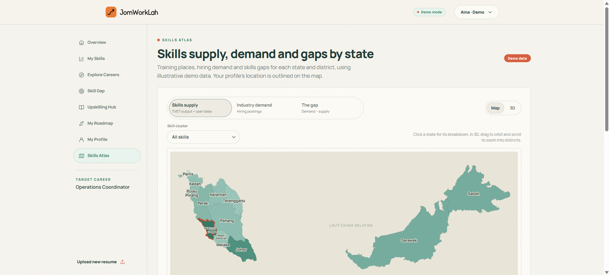</td>
    <td width="50%">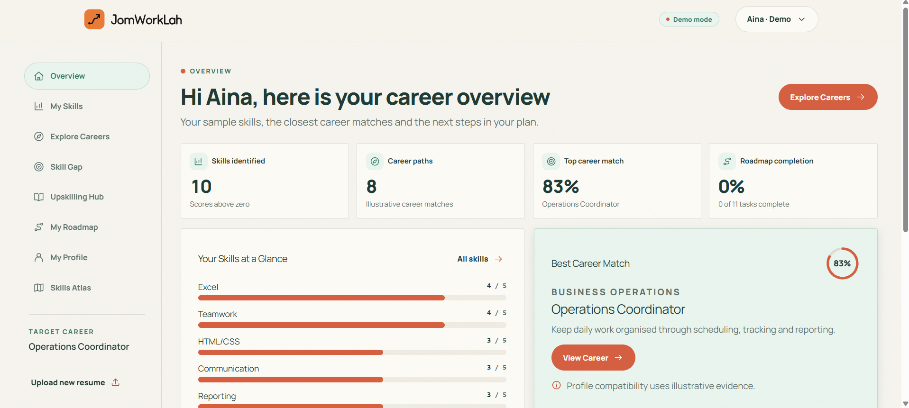</td>
  </tr>
  <tr>
    <td align="center"><b>1 · Skills Atlas</b><br/><sub>Training supply, hiring demand and the gap between them, state by state. Aina's Selangor is outlined in orange; the cluster selector and the Map/3D toggle sit above the choropleth.</sub></td>
    <td align="center"><b>2 · Overview</b><br/><sub>Where the app lands after parsing: 10 evidenced skills, 8 career paths, an 83% top match, and a roadmap at 0 of 11 tasks.</sub></td>
  </tr>
  <tr>
    <td width="50%">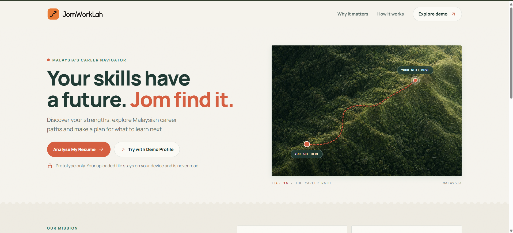</td>
    <td width="50%">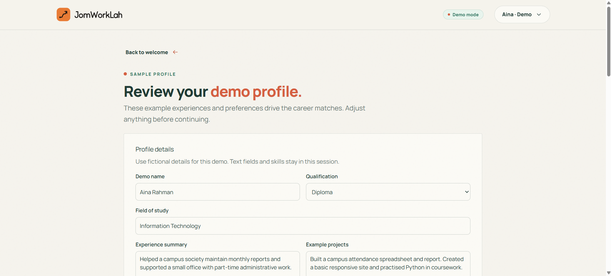</td>
  </tr>
  <tr>
    <td align="center"><b>3 · Landing</b><br/><sub><em>Analyse My Resume</em> starts the upload; <em>Try with Demo Profile</em> loads a persona. The lock note is literal — the file never leaves the device.</sub></td>
    <td align="center"><b>4 · Profile review</b><br/><sub>The parsed profile, shown before it drives anything. Every field is editable, so you can change an input and watch the outputs move.</sub></td>
  </tr>
  <tr>
    <td width="50%">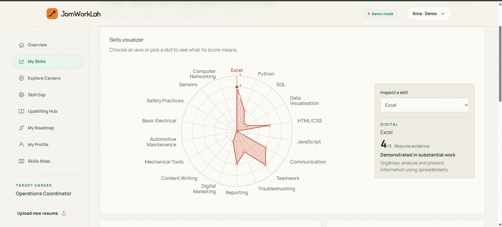</td>
    <td width="50%">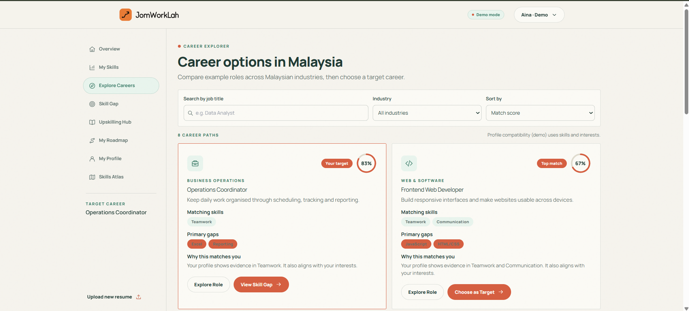</td>
  </tr>
  <tr>
    <td align="center"><b>5 · My Skills</b><br/><sub>The 18-axis radar is hand-built inline SVG, no charting library. Picking an axis grades the claim: Excel at 4/5 reads as <em>demonstrated in substantial work</em>.</sub></td>
    <td align="center"><b>6 · Explore Careers</b><br/><sub>All eight paths ranked by fit, the target badged, top matches marked, and a plain-language <em>Why this matches you</em> under each card.</sub></td>
  </tr>
  <tr>
    <td width="50%">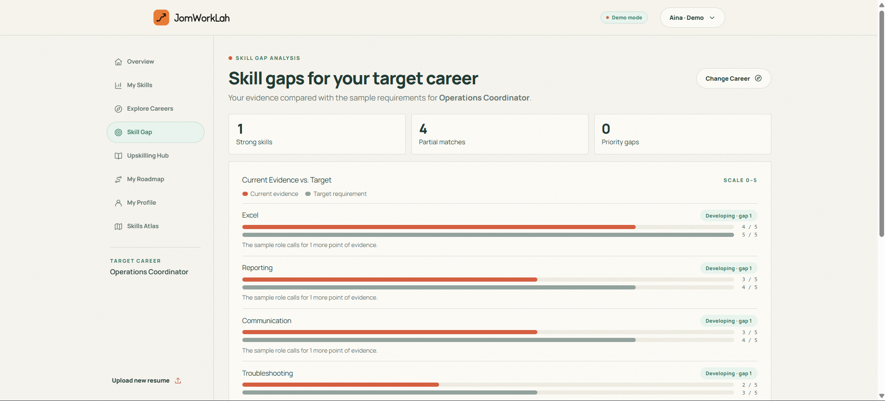</td>
    <td width="50%">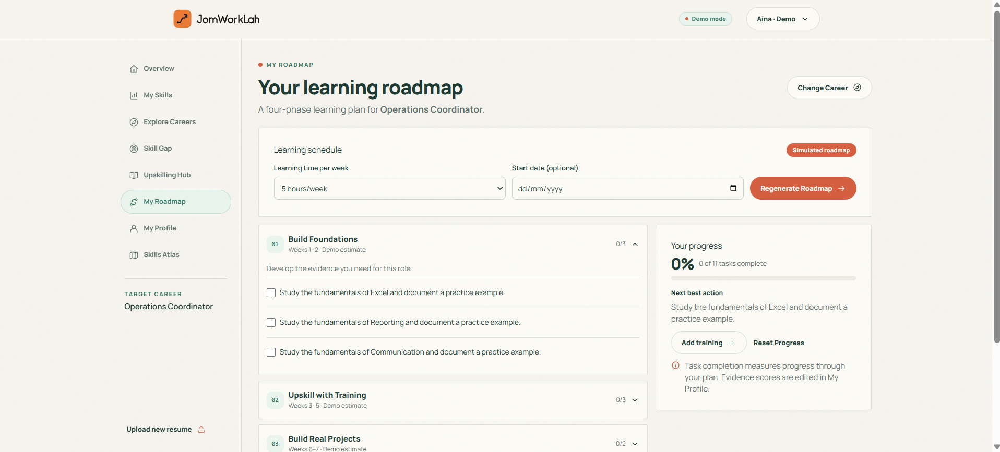</td>
  </tr>
  <tr>
    <td align="center"><b>7 · Skill Gap</b><br/><sub>Current evidence against each target level, bar by bar. Operations Coordinator needs one more point on four skills, so this persona has no priority gaps to chase.</sub></td>
    <td align="center"><b>8 · My Roadmap</b><br/><sub>Four phases compressed to 5 hours a week, 11 tasks, an optional start date, and a <em>Next best action</em> that follows whatever is still open.</sub></td>
  </tr>
  <tr>
    <td colspan="2">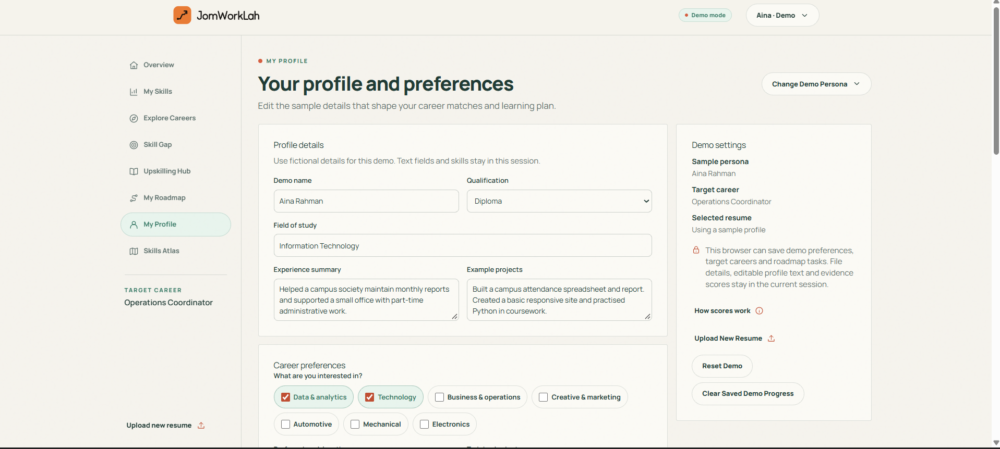</td>
  </tr>
  <tr>
    <td colspan="2" align="center"><b>9 · My Profile</b><br/><sub>Interests, budget, weekly hours and learning mode live here, next to the controls that reset the journey. This is where the personalisation demo happens.</sub></td>
  </tr>
</table>

> [!TIP]
> Two screens still need captures: the **Upskilling Hub** (`#/upskilling`) and the **employer talent
> search** (`/employer`). Add them as `10-upskilling.png` and `11-employer.png` and extend the table.

---

## 3. How It Works

Five steps take a user from a messy CV to a dated study plan.

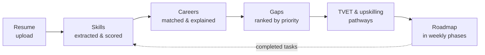

| Step | What the AI does | In the app |
|---|---|---|
| **1 · Skills assessment** | Parses the resume and the user's own description of their experience into evidence-backed competencies — including skills picked up from hobbies, informal work and self-teaching. | Resume upload → *Review your demo profile* |
| **2 · Career matching** | Ranks Malaysian career paths by fit and **explains why** each one suits the user, instead of just outputting a list. | *Explore Careers* with fit rings and plain-language reasoning |
| **3 · Gap analysis** | Subtracts current evidence from the role's weighted requirements and orders what is missing by how much it matters. | *Skill Gap* with *Where to start* |
| **4 · TVET recommendations** | Matches gaps to real Malaysian TVET programmes from the national TVET portal, searchable by state, qualification type and tuition status, showing the institutions that offer each one and linking to the official listing. | *Upskilling Hub* |
| **5 · Career roadmap** | Builds a step-by-step plan across four phases, sized to the user's weekly study hours, and tracks completion. | *My Roadmap* |

---

## 4. Feature Map

Every feature below exists in the running app, not just in the pitch.

<table>
  <thead><tr><th>#</th><th>Feature</th><th>Where it lives</th></tr></thead>
  <tbody>
    <tr><td>1</td><td><b>Resume upload</b> — drag-and-drop PDF or DOCX, validated client-side</td><td><code>#/upload</code></td></tr>
    <tr><td>2</td><td><b>AI resume parser / profile builder</b> — education, experience, projects, certifications into an editable profile</td><td><code>POST /api/parse-resume</code> → <code>#/profile-review</code></td></tr>
    <tr><td>3</td><td><b>Career preference setup</b> — interests, location, budget, weekly hours, learning mode, MBTI</td><td><code>#/profile</code></td></tr>
    <tr><td>4</td><td><b>Skills extraction and scoring</b> — every competency graded 0–5 against its evidence</td><td><code>#/skills</code></td></tr>
    <tr><td>5</td><td><b>Interactive skills dashboard</b> — hand-built SVG radar chart plus category bar meters, no charting library</td><td><code>#/skills</code></td></tr>
    <tr><td>6</td><td><b>Career recommendation engine</b> — all eight paths ranked, top three badged</td><td><code>#/careers</code></td></tr>
    <tr><td>7</td><td><b>Career compatibility score</b> — a fit ring split into its skill and interest components</td><td><code>#/careers</code>, career detail dialog</td></tr>
    <tr><td>8</td><td><b>Career explorer</b> — description, responsibilities, qualifications, requirements, progression ladder</td><td>career detail dialog</td></tr>
    <tr><td>9</td><td><b>Skills gap analysis</b> — strong / partial / priority-gap counters per role</td><td><code>#/gap</code></td></tr>
    <tr><td>10</td><td><b>Skills comparison chart</b> — current evidence vs target level, bar by bar</td><td><code>#/gap</code></td></tr>
    <tr><td>11</td><td><b>Gap prioritisation</b> — missing skills ranked by gap × requirement weight</td><td><code>#/gap</code> → *Where to start*</td></tr>
    <tr><td>12</td><td><b>TVET programme recommender</b> — pathways scored by how many of your gaps they close</td><td><code>#/upskilling</code></td></tr>
    <tr><td>13</td><td><b>TVET course catalogue</b> — 476 programmes at 183 institutions from the national TVET portal (tvet.gov.my), loaded from Supabase</td><td>state and qualification filters</td></tr>
    <tr><td>14</td><td><b>Training directory</b> — English and Malay names, duration, offering institutions by state, tuition-free flag and a link to each official listing</td><td><code>#/upskilling</code> (search plus 5 filters, 24 results per page)</td></tr>
    <tr><td>15</td><td><b>AI career roadmap</b> — four phases sized to your weekly hours, with dated schedule</td><td><code>#/roadmap</code></td></tr>
    <tr><td>16</td><td><b>Practical project recommender</b> — role-specific portfolio briefs generated for IT careers</td><td>roadmap phase 3</td></tr>
    <tr><td>17</td><td><b>Skills Atlas</b> — an interactive Malaysia-wide map of training supply, industry demand and the gap between them, in 2D and 3D</td><td><code>#/atlas</code></td></tr>
    <tr><td>18</td><td><b>Employer talent search</b> — the same matching engine, pointed the other way</td><td><code>/employer</code></td></tr>
    <tr><td>19</td><td><b>Holland Code (RIASEC) interest matching</b> — pick up to three letters, or take the free O*NET Interest Profiler first; roles with a closer Holland Code rank higher (browser demo only)</td><td><code>#/profile</code>, <code>#/careers</code></td></tr>
  </tbody>
</table>

---

## 5. Who It Is For

| Segment | Age | Their problem | What Jom Kerja Lah gives them |
|---|---|---|---|
| **SPM leavers and secondary students** · primary | 16–20 | No career direction, barely aware TVET exists | Career discovery, skills assessment, TVET recommendations |
| **TVET students and graduates** · primary | 17–25 | Can't find the job their training actually leads to | Skills-to-job matching, targeted upskilling, roadmaps |
| **Fresh graduates and young jobseekers** · secondary | 20–30 | Skills mismatch, thin work history | Transferable-skill detection and job-readiness guidance |
| **Working adults and career switchers** · secondary | 25+ | Outdated skills, unrecognised experience | Reskilling paths and recognition of prior learning |
| **Institutions and TVET providers** · B2B | org | No scalable career counselling | Cohort skills insight and training-gap reporting |
| **Employers** · B2B | org | Screening CVs against vague job specs | Evidence-graded candidate search with explainable match scores |

Two personas carry the demo, chosen to sit on opposite sides of the TVET divide:

| | **Aina Rahman** | **Amir Hakim** |
|---|---|---|
| Background | IT diploma graduate, Selangor | SPM leaver, family motorcycle workshop, Perak |
| Type | INFJ | ISTP |
| Target career | Junior Data Analyst | Automotive Technician |
| Biggest gaps | SQL, Data Visualisation, Python | Safety, Electrical, Sensors, Troubleshooting |
| Roadmap emphasis | Courses and dashboards | Supervised technical projects |

---

## 6. Architecture

```
QodeFest/
├── frontend/          Next.js 16 app, static export, both demo sites
│   ├── app/candidate/     job-seeker shell (header, sidebar, dialogs)
│   ├── app/employer/      employer talent search
│   └── public/js/         the SPA, API client (api.js, config.js), mock careers and skills, Skills Atlas
├── backend/           Express 5 API: Supabase Postgres for application data and the course catalogue
│   ├── src/domain/        pure engine: scoring, roadmap, assessment, resume mapping
│   ├── src/ai/            rule adapter · LLM adapter · DeepSeek OCR client
│   ├── src/routes/        thin HTTP layer
│   ├── src/services/      catalogue cache (Supabase), journeys, training, profile
│   ├── src/import/        cleaning and skill keywords for the course import
│   ├── scripts/           import, translate and skill-mapping tools for the catalogue
│   ├── supabase/          catalogue schema, application schema and generated seed SQL
│   └── test/              80 tests, including prototype-parity assertions
├── slide deck/        the pitch deck (jom-kerja-lah.html)
└── docs/screenshots/  the nine captures in section 2
```

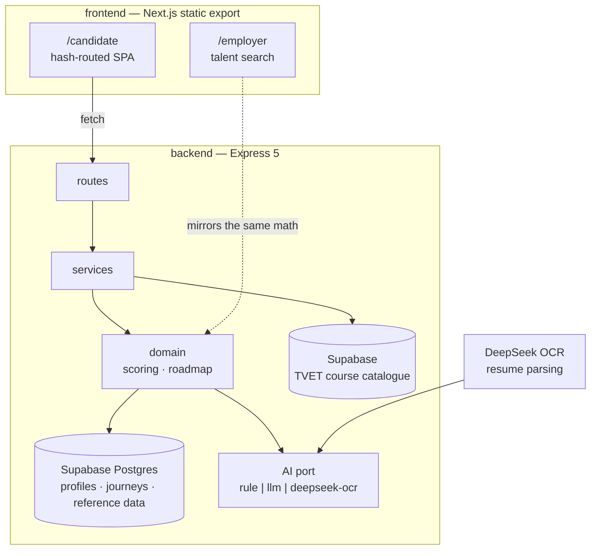

> [!IMPORTANT]
> **Current state of wiring.** The candidate app now talks to the API. The course catalogue (from
> Supabase) and each persona's profile, target career, saved pathways and roadmap come from the backend,
> so **the backend must be running** for the Upskilling Hub and roadmap to work. If it is down the app
> shows an error with a retry button, not fake data. Career matching, the skills radar, Holland Code and
> MBTI are still computed in the browser (the backend implements the same career maths, pinned by parity
> tests), and the employer site still uses its own mock candidates.

---

## 7. Quick Start

Node.js **24 or newer** is required.

### Frontend

```bash
cd frontend
npm install
npm run dev
```

| Open | For |
|---|---|
| <http://localhost:3000/candidate> | the job-seeker walkthrough |
| <http://localhost:3000/employer> | talent search |

`/` redirects to `/candidate`. Use `localhost`, not `127.0.0.1`, unless `allowedDevOrigins` in
[next.config.mjs](frontend/next.config.mjs) covers your host.

Start the backend first: the candidate app loads courses and saves progress through the API. Locally it
uses `http://localhost:8787/api`; production defaults to `https://jomworklah.onrender.com/api`.
Set `NEXT_PUBLIC_API_BASE` during the frontend build to override either URL.

The app degrades gracefully offline: layout, charts and every interaction work on local CSS and system
fonts. An internet connection additionally loads the webfonts, Tailwind utilities from CDN, the 3D Atlas
view and outbound links to official training portals.

### Backend

```bash
cd backend
npm install
```

Set `DATABASE_URL` to the Supabase PostgreSQL connection string, plus `SUPABASE_URL` and
`SUPABASE_SERVICE_ROLE_KEY` for the TVET catalogue, in `backend/.env`. Keep these backend credentials
private. Initialize the database and start the API:

```bash
npm run db:migrate
npm run db:seed
npm run dev               # http://localhost:8787
```

```bash
curl http://localhost:8787/api/health
# {"data":{"status":"ok","db":"ok","catalogue":{"source":"supabase","courses":476,"loadedAt":"..."}}}
```

Real resume parsing switches on automatically once `DEEPSEEK_API_KEY` is set in `.env`. Without a key,
`POST /api/parse-resume` returns realistic sample data honestly flagged `"is_simulated": true`, so the
flow is still demoable.

Resume parsing uses [DeepSeek's official OCR API](https://api-docs.deepseek.com/api/ocr/)
(`POST /v1/tools/ocr`), followed by a chat completion to produce the existing resume JSON.
PDF and DOCX are supported. The OCR request creates no Files API resource to delete.
OCR and structured extraction are two separately billed API calls.

Set these values in `backend/.env` and restart the backend:

| Variable | Default / purpose |
|---|---|
| `DEEPSEEK_API_KEY` | Your backend-only DeepSeek key; empty means simulated auto mode |
| `DEEPSEEK_BASE_URL` | `https://api.deepseek.com` (optional `/v1` suffix accepted) |
| `DEEPSEEK_MODEL` | `deepseek-flash`, the text-to-JSON model after OCR |
| `DEEPSEEK_OCR_PURPOSE` | `text_recognition`, or `rich_layout_recognition` |
| `DEEPSEEK_OCR_TIMEOUT_MS` | `180000` per OCR request |
| `DEEPSEEK_TIMEOUT_MS` | `60000` per structured extraction request |
| `DEEPSEEK_MAX_TEXT_CHARS` | `120000`; longer recognition results are rejected |

These replace the old `DASHSCOPE_API_KEY` and `QWEN_*` settings. Use `?mode=live` to
require real extraction; missing credentials and provider failures return errors.
The independent `AI_*` settings still control narrative assessment and career explanations.
The candidate app's resume upload step is still simulated; it does not call `POST /api/parse-resume` yet.

### Supabase database

Application profiles, sessions, skills, careers, preferences and roadmaps are stored in Supabase
Postgres. The API uses the server-only `DATABASE_URL` connection string. It also loads the TVET course
catalogue from Supabase at startup, keeps it in memory and refreshes every 10 minutes
(`CATALOGUE_REFRESH_MS`).

| Variable | Purpose |
|---|---|
| `DATABASE_URL` | Supabase Postgres connection string; keep it backend-only |
| `SUPABASE_URL` | the project URL |
| `SUPABASE_SERVICE_ROLE_KEY` | the **Secret** key. Backend only: never put it in the frontend or commit it |

For a new Supabase project, run [`backend/supabase/schema.sql`](backend/supabase/schema.sql),
[`backend/supabase/app-schema.sql`](backend/supabase/app-schema.sql), then
[`backend/supabase/seed.sql`](backend/supabase/seed.sql) in the SQL Editor. The first file creates the
TVET catalogue tables; the latter two create and seed the application tables. `npm run db:migrate` and
`npm run db:seed` apply the same SQL using `DATABASE_URL`. Existing course-catalogue tables/data are
preserved when reapplying the idempotent schema. For an existing app database, reapply
`app-schema.sql` to add new profile columns, then `seed.sql` to refresh demo templates. Existing
browser-stored MBTI/Holland choices sync to Supabase when that persona is next loaded.

The seed file is generated from the built-in demo/reference data:

```bash
cd backend
npm run supabase:seed:generate
```

### Deploy to Vercel and Render

1. In Supabase, get the PostgreSQL connection string (use the transaction pooler where appropriate)
   and set it as `DATABASE_URL` in `backend/.env`, then run `npm run db:migrate` and `npm run db:seed`.
2. Deploy the repository's `render.yaml` blueprint. In Render, set `DATABASE_URL`,
   `SUPABASE_URL`, and `SUPABASE_SERVICE_ROLE_KEY` to the Supabase values. `FRONTEND_ORIGIN`
   defaults to the production Vercel site; add preview or custom frontend origins as needed. Do not
   expose the database URL or service-role key to the browser.
3. Create a Vercel project rooted at `frontend/`. The frontend defaults to
   `https://jomworklah.onrender.com/api`; set `NEXT_PUBLIC_API_BASE` to override it and deploy.
4. Confirm the Render health endpoint at `https://your-api.onrender.com/api/health`.

For Vercel preview deployments, add their origins to the comma-separated `FRONTEND_ORIGIN` allowlist
if you need previews to call the API.

To load the catalogue into a new Supabase project:

1. Run [`backend/supabase/schema.sql`](backend/supabase/schema.sql) in the Supabase SQL editor. It creates the tables, row-level security and grants.
2. Put the TVET export at `backend/data/tvet_courses_first_1000.xlsx` (the `data/` folder is gitignored).
3. From `backend`, run the steps in order:

```bash
node --env-file=.env scripts/import-courses.mjs               # dry run: clean, merge, report
node --env-file=.env scripts/import-courses.mjs --write       # upsert institutions, courses, offerings
node --env-file=.env scripts/translate-courses.mjs            # DeepSeek Malay -> English, cached in data/
node --env-file=.env scripts/translate-courses.mjs --write    # save the translations
node --env-file=.env scripts/map-course-skills.mjs            # dry run: keyword report
node --env-file=.env scripts/map-course-skills.mjs --write    # save course -> skill links
```

Every step can be re-run safely. Skill keywords (English and Malay) live in
`backend/src/import/skill-keywords.js`. If several people share one Supabase project, tell the team before
re-running a `--write` step, because it changes everyone's data.

### Optional local SQLite import (offline tool)

This separate tool imports the scraper's 20-column `Courses` worksheet into a local SQLite
database (`DB_PATH`, default `backend/data/jomworklah.db`). It does not populate Supabase
or the app's live catalogue. For live data, use the Supabase import steps above. From `backend/`:

```powershell
npm run db:import:tvet -- "C:\path\to\tvet_courses_first_1000.xlsx"
```

Reading `.xlsx` requires Python 3 (standard library only, no pip packages). If `python`
is unavailable, append `--python "C:\path\to\python.exe"`. A JSON array with the same
column names is also accepted and does not require Python.

The importer backs up an existing database before migrating it. Imports run in one
transaction, retain demo courses and saved user data, and update existing source IDs
instead of creating duplicates. TVET IDs are namespaced, e.g. `tvet-7111`. Institutions
become providers. All original cell values are retained in `courses.source_data_json`.

Migration 3 adds course codes, descriptions, qualification levels, original duration
and its unit, entry requirements, career prospects, source URLs, scrape metadata and
extra attributes. Unknown modes, fees and week ranges remain `NULL`. Months and days
are not converted into invented week ranges; `0 Bulan` remains a raw zero duration.
Missing/invalid institution links are omitted as clickable URLs while preserving the
source value. These are scraped listings, not verified current intake availability.

The local importer initially creates no `course_skills` links. Its SQLite rows are retained
for offline inspection, including saved course references and roadmap snapshots. The running
API reads the Supabase catalogue cache; it does not serve rows from this local database.

---

## 8. API Reference

Base path `/api`. JSON in and out, except the multipart resume upload. Auth is a bearer token from
`POST /api/session` or `POST /api/demo/session`; there are no passwords, and every user row is
hard-deleted by `DELETE /api/me`.

Responses use one envelope: `{ "data": ... , "meta": ... }` or `{ "error": { "code", "message", "details" } }`.

| Method | Path | Auth | Purpose |
|---|---|---|---|
| `GET` | `/health` | – | liveness, DB check and which course catalogue is loaded |
| `POST` | `/session` | – | create a guest user and token |
| `GET` | `/demo/personas` | – | list seeded personas |
| `POST` | `/demo/session` | – | clone a persona into a fresh user |
| `GET` | `/me` | ✔ | profile, interests, skill scores, journey, roadmap summary |
| `PATCH` | `/me/profile` | ✔ | update profile fields |
| `PUT` | `/me/skills` | ✔ | bulk-upsert evidence scores |
| `PATCH` | `/me/skills/:skillId` | ✔ | update one score |
| `PUT` | `/me/interests` | ✔ | replace the interest set |
| `GET` | `/skills` · `/interests` | – | catalogues and the evidence legend |
| `GET` | `/courses` | – | the whole TVET course catalogue (476 programmes with their offering institutions) |
| `GET` | `/courses/:id` | – | one programme with English and Malay text, career prospects and full institution details |
| `GET` | `/careers?query=&category=&sort=` | ✔ | ranked careers with fit |
| `GET` | `/careers/:id` | ✔ | detail, requirements, per-skill gaps, explanation |
| `GET` | `/training?view=&skill=&source=&mode=&location=&budget=&sort=` | ✔ | ranked and filtered programmes (a state matches any offering institution) |
| `GET` | `/training/:id` | ✔ | course detail with provider |
| `PUT` | `/me/target` | ✔ | set target career — invalidates the roadmap |
| `GET` `POST` `DELETE` | `/me/courses[/:courseId]` | ✔ | save and unsave pathways |
| `GET` `POST` | `/me/roadmap` | ✔ | derive, generate or regenerate the plan |
| `PATCH` | `/me/roadmap/tasks/:taskId` | ✔ | toggle a task |
| `POST` | `/me/roadmap/reset-progress` | ✔ | clear completions, keep the plan |
| `DELETE` | `/me/journey` · `/me` | ✔ | clear the journey · delete everything |
| `POST` | `/parse-resume?mode=&persist=` | ✔ | multipart PDF/DOCX → structured profile + skill evidence |
| `POST` | `/ai/assessment` | ✔ | free-text narrative → detected skills and interests |
| `POST` | `/ai/explain-match` | ✔ | plain-language justification for a match |
| `POST` | `/dev/reset` | dev | wipe and reseed, needs `ALLOW_DEV_RESET=1` |

<details>
<summary><b>Example: clone Aina, then ask what suits her</b></summary>

```bash
TOKEN=$(curl -s -X POST http://localhost:8787/api/demo/session \
  -H 'content-type: application/json' -d '{"personaKey":"aina"}' | jq -r .data.token)

curl -s "http://localhost:8787/api/careers/junior-data-analyst" \
  -H "authorization: Bearer $TOKEN" | jq '.data | {compatibility, requirements}'
```

```json
{
  "compatibility": { "fit": 61, "skillsMatch": 54, "interestMatch": 100 },
  "requirements": [
    { "skillId": "sql",     "level": 4, "weight": 0.30, "current": 1, "gap": 3, "priority": 0.90 },
    { "skillId": "data-viz","level": 4, "weight": 0.25, "current": 1, "gap": 3, "priority": 0.75 },
    { "skillId": "python",  "level": 3, "weight": 0.15, "current": 2, "gap": 1, "priority": 0.15 }
  ]
}
```
</details>

---

## 9. The Matching Engine

No black box: a score is always reproducible from the user's evidence and the role's weights, and the
same math runs in the browser demo, the API, and the employer site.

**Evidence legend** — each skill is graded 0–5 on how well it is *proven*, not claimed:

`0` no evidence · `1` mentioned · `2` coursework · `3` project evidence · `4` substantial work · `5` independently verified

```
gap       = max(0, requirement.level − current)
priority  = gap × requirement.weight

skillsMatch   = round(100 × Σ min(current ÷ level, 1) × weight)
interestMatch = 100 when any interest overlaps, else 50
fit           = round(0.85 × skillsMatch + 0.15 × interestMatch)
```

The inner `skillsMatch` rounds **before** weighting — a detail the parity tests pin down, because it
changes the published numbers.

**Holland Code (RIASEC) — optional fifth signal in the browser demo.** On `#/profile` the user picks up
to three letters (Realistic, Investigative, Artistic, Social, Enterprising, Conventional), strongest
first. Users who do not know their code can open the free
[O*NET Interest Profiler](https://www.mynextmove.org/explore/ip) from the same section, then come back
and pick their top three. Each of the eight roles carries its own three-letter code. Letters are
weighted 3 / 2 / 1 by rank:

```
hollandMatch = round(100 × Σ userWeight × jobWeight ÷ Σ userWeight²)     over letters both share
fit          = round(0.70 × skillsMatch + 0.15 × interestMatch + 0.15 × hollandMatch)
```

With no letters selected the original `0.85 / 0.15` formula applies unchanged, so existing demo results
do not move. When letters are selected, the role card adds a line such as "Holland Code ICE is a 85%
match with your ICR." The selection is saved with the persona's other preferences. The logic lives in
`frontend/public/js/app.js` (`hollandMatch`, `compatibility`) and the role codes in
`frontend/public/js/mock-data.js` (`jobHolland`). The backend API and employer site do not use it yet.

**Course relevance** sums the priorities of the gaps a programme closes (its skills come from the
`course_skills` table), then breaks ties on learning mode
and location. A programme counts as "in" a state when any institution offering it is there. Its `fee` is
`0` when at least one institution states that tuition is free and `NULL` otherwise, which means "price
to verify" (the portal export has no prices). Budget limits map `RM0–RM500` → 500 and
`RM501–RM1,500` → 1500.

**Roadmap** phases recompute on every read from the profile, target and saved courses, with deterministic
task IDs (`skill-sql`, `course-…`, `project-1`, `prepare-resume`). Only completion state is stored. Phase
length scales with effort:

```
phaseWeeks = max(1, ceil(baseWeeks × 5 ÷ weeklyHours))     baseWeeks = [2, 3, 2, 1]
```

so 8 hours a week compresses Aina's plan from `[2, 3, 2, 1]` to `[2, 2, 2, 1]`. Training tasks for real
programmes read "check entry requirements and intake dates … then shortlist an institution", because most
programmes last months or years, far longer than the training phase.

### The AI layer

| Adapter | Role |
|---|---|
| `rule-adapter` | default, offline, deterministic — alias and keyword extraction with confidence scores |
| `llm-adapter` | optional OpenAI-compatible narrative assessment and match explanation, 8s timeout, falls back to rules on any failure |
| `deepseek-ocr` | Official DeepSeek OCR for PDF/DOCX text recognition, followed by `deepseek-flash` for structured resume JSON; no Files API resource is created |

Intelligence sits behind a port, so scoring never blocks on a provider and no adapter can corrupt a
roadmap. The planned next signal is **semantic skill matching with Sentence Transformers**
([sbert.net](https://www.sbert.net/)): embeddings compare the *meaning* of a student's skills against
career requirements, so "I enjoy fixing electronic devices" can reach an electronics occupation without
sharing a single keyword with the job title. That plugs into the existing ranking as an additional
signal — no schema change required.

---

## 10. Data Catalogue

Everything the recommendations are grounded in, counted from the seed:

| Entity | Count | Notes |
|---|---:|---|
| Skills | **18** | Digital, Technical, Analytical, Communication, Teamwork |
| Interest clusters | **7** | drives the 15% interest component |
| Career paths | **8** | each with weighted requirements, responsibilities, progression, project briefs |
| Training institutions | **183** | public and private TVET institutions from the national portal (Supabase) |
| TVET programmes | **476** | merged from 1,000 portal listings (a sample of about 21,600), with 1,000 institution offerings; English text is machine-translated |
| Course-skill links | **345** | keyword mapping to the 18 skills; 236 programmes match none |
| MBTI types | **16** | with generated persona art |
| Holland (RIASEC) types | **6** | with an illustrative three-letter code on each of the 8 careers (browser demo) |
| Demo personas | **2** | Aina (IT diploma) and Amir (SPM + workshop) |
| Employer candidates | **12** | 10 shared, 2 exclusive |
| Atlas states / districts | **14 / 158** | official DOSM boundaries |
| Atlas skill clusters | **10** | semiconductor, software, media, logistics, automotive, energy, hospitality, healthcare, construction, agrotech |

Skills, interests, careers and personas are curated and read-only, seeded from `backend/src/db/seed-data.js` in one transaction with
`INSERT OR IGNORE` — reruns are safe, and seeding **fails loudly** if any job's requirement weights do
not sum to 1.0 or a skill reference is missing.

<details>
<summary><b>The eight career paths</b></summary>

Junior Data Analyst · Business Intelligence Analyst · Frontend Web Developer · IT Support Technician ·
Digital Marketing Executive · Operations Coordinator · Automotive Technician · Industrial Maintenance Technician

</details>

---

## 11. Demo Walkthrough

Judged on stage, this runs in about three minutes. Start the backend first (`cd backend && npm run dev`) so the training and roadmap steps work.

1. **Try with Demo Profile → Aina Rahman.** Review her IT experience, **Save & Continue**.
2. **Explore Careers.** Open **Junior Data Analyst**, pick it as the target. The gap view highlights SQL and Data Visualisation.
3. **Find Training for These Gaps.** Read a pathway, follow its official portal link, or add it to the roadmap.
4. **My Roadmap.** Set weekly hours, generate, tick one task, then check the new percentage in **Overview**.
5. Switch to **Amir Hakim** and choose **Automotive Technician** — different skills, technical pathways, supervised projects. Then open **Skills Atlas**: swap between supply, demand and the gap; select a skill cluster; click a state into its districts; flip to 3D. The active persona's state is outlined in orange.

**To prove personalisation**, change Aina's SQL evidence from 1 to 3 in **My Profile** and save. Watch her
compatibility, her gap ordering and her regenerated roadmap all move — evidence in, plan out.

Resume selection accepts a sample PDF or DOCX up to 5 MB; the browser keeps only the filename and size in
memory, so nothing personal is uploaded during the demo.

---

## 12. Testing and Verification

```bash
cd backend && npm test
```

**80 tests, 0 failures.** They run against in-memory SQLite and a built-in 10-course fixture (never a live Supabase project) and cover behavior that could otherwise drift
silently:

| Suite | Guards |
|---|---|
| `scoring.test.js` | Aina→Junior Data Analyst `fit=61`, Amir→Automotive `fit=77`, gap ordering, interest-match branch, rounding at boundaries, evidence caps |
| `roadmap.test.js` | week formula at 3/5/8 hours, fallback tasks, stable IDs, saved-course union, completions preserved on regeneration, orphan pruning |
| `seed.test.js` | idempotent reruns, weights sum to 1, foreign-key integrity, expected catalogue counts |
| `api.test.js` + `parse-resume.test.js` | session bootstrap, validation and auth failures, upload type and size rejection |
| `deepseek-ocr.test.js` | PDF/DOCX multipart OCR, structured extraction, environment settings, provider errors and incomplete output (mocked provider; no paid API calls) |
| `import-tvet.test.js` | schema migration preserves references, imports are repeatable and atomic, missing data stays unknown, imported course shapes work in training and roadmaps using an injected test catalogue |

Parity is the point: the assertions encode the **frontend prototype's** published numbers, so the engine
and the UI cannot quietly disagree.

```bash
bash backend/scripts/smoke.sh          # needs curl + jq against a running API
```

Security is structural rather than bolted on — prepared statements only, `ORDER BY` mapped from a
whitelist, SHA-256-hashed bearer tokens, Zod validation with unknown keys stripped and length caps, a
128 kB body limit, magic-byte verification on uploaded resumes, and an origin allowlist for CORS.

---

## 13. Tech Stack

| Layer | Choice | Why |
|---|---|---|
| Frontend | Next.js 16 · React 19 · `output: "export"` | one static site, both demos, trivially hostable |
| Interaction | vanilla hash-routed SPA | no hydration edge cases for a click-through demo |
| Charts | hand-rolled inline SVG | the radar and meters are exactly what we want, no dependency |
| 3D Atlas | Three.js r128 from CDN | extruded demand columns over real boundaries |
| Styling | own design system + Tailwind CDN | the CSS carries the identity; utilities for speed |
| Backend | Node 24 · Express 5 · Zod | same language as the frontend |
| Database | Supabase Postgres for application state and the course catalogue | durable shared data; backend-only database credentials |
| AI | rule engine → OpenAI-compatible → DeepSeek OCR + `deepseek-flash` | offline-first, live when a key exists |
| Tests | `node:test` | no runner to install |

Brand palette, for reference: paper `#f5f3ec`, ink `#173c35`, teal `#087a63`, accent `#e65536`, route orange `#f97316`.

---

## 14. Honest Limitations

The pitch is stronger when the numbers are trustworthy, so the boundaries are stated in the product itself.

- **The course catalogue is a sample of real listings.** It holds the first 1,000 of about 21,600 programmes on the TVET portal, so coverage is partial. Intake dates, fees, eligibility and recognition must be confirmed with each institution. The export has no prices, so `fee` is `0` only where tuition is explicitly free and otherwise unknown. English text is machine-translated from Malay and has not been proofread.
- **The catalogue skews technical.** Almost no programme teaches Excel, Python, JavaScript or reporting, so data and business careers get weak course recommendations, while automotive, electrical and mechanical roles get many. About half of the programmes match none of the 18 skills (for example bricklaying or fashion) and appear only in search. Skill links come from keyword matching, so a few are wrong.
- **Programmes are long.** Most last 1.5 to 3 years, not the weeks the original roadmap assumed, and the export has no delivery mode, so every programme is treated as on-campus.
- **Compatibility weights (85/15) and requirement levels are illustrative**, chosen to be defensible rather than derived from a validated labour-market model.
- **Holland Code is self-reported.** Picks are saved with the Supabase profile, but role codes remain illustrative approximations rather than an official O*NET lookup, and the 70/15/15 weighting is a design choice. The external O*NET test is English only and its result is entered by hand.
- **Skills Atlas mixes real and synthetic data.** State and district geometry comes from official DOSM/open data; supply, demand, gap, employer and institution figures are synthetic and labelled "Demo data".
- **No job-board ingestion yet** — careers and their requirements are curated seed data. Only the TVET programmes come from a real export.
- **The candidate app depends on the API for profiles and saved progress, but not for everything.** Career matching still runs in the browser; MBTI and Holland selections are persisted to the profile in Supabase. Resume upload is simulated, and the employer site is still mock data. If the API is down the Upskilling Hub shows an error.
- Privacy is minimal by design: no email, no passwords, no server-side resume retention after parsing.

### Data sources the product is built to use

| Source | Application |
|---|---|
| **TalentCorp MyCOL** | occupations experiencing talent shortages |
| **MySPIKE / NOSS** | nationally defined occupational competencies |
| **UP_TVET** | recognised training courses and application pathways |
| **MYFutureJobs** | live job opportunities |

---

## 15. What Comes Next

| Priority | Work |
|---|---|
| **Now** | Import the remaining ~20,000 TVET listings, add IT and business short courses so data and marketing careers get recommendations, and compress the course list (about 570 KB today) |
| **Next** | Move career matching, Holland Code and MBTI to the API so a profile is the same on every device |
| **Next** | Semantic skill matching with Sentence Transformers, replacing keyword overlap as the primary signal |
| **Next** | Ingest MySPIKE/NOSS competencies and MYFutureJobs postings so requirements and demand are live rather than curated |
| **Later** | Real authentication, cohort dashboards for TVET institutions, RPL (recognition of prior learning) pathways |
| **Later** | Bahasa Malaysia support — the current NLP is English-only |

---

## 16. References

**Built for** the *Reimagine Malaysia* hackathon theme.

- Problem data: [DOSM Labour Force Survey 2025](https://www.dosm.gov.my/portal-main/release-content/labour-force-survey-2025) · [DOSM skills underemployment release](https://www.dosm.gov.my/uploads/release-content/file_20260626114308.pdf) · [OECD Economic Surveys: Malaysia 2026 — Improving skills, education and training](https://www.oecd.org/en/publications/oecd-economic-surveys-malaysia-2026_9ab6b826-en/full-report/improving-skills-education-and-training_562c8471.html)
- Malaysian platforms referenced: [TalentCorp](https://www.talentcorp.com.my/) · [MYFutureJobs / PERKESO](https://www.myfuturejobs.gov.my/) · [HRD Corp](https://www.hrdcorp.gov.my/) · [UP_TVET](https://uptvet.moe.gov.my/)
- Matching approach: [Sentence Transformers](https://www.sbert.net/)
- Repository: [frontend](frontend/README.md) · [backend design and data model](backend/MODELS_PLAN.md) · [pitch deck](<slide deck/jom-kerja-lah.html>) · [Skills Atlas prototype](frontend/public/js/skills-atlas.js)

<details>
<summary>Hero artwork prompt</summary>

> Create an ultra-polished editorial hero artwork for a Malaysian early-career guidance website, landscape 3:2 composition. Photoreal fine-grained drone photograph, STRAIGHT DOWN top-down look into the densely forested tropical mountain ridges of Peninsular Malaysia with fine tiny canopy texture and dark green folds. Graphic outdoor atlas art direction, tightly cropped with no horizon or sky. The ridge should run diagonally from bottom-left through the middle towards upper-right and must be darker on left and bottom with brighter muted fern and sage at upper right. Desaturated olive, deep forest greens, warm sage, slight warm cinematic grading; crisp print-like detail with dappled shadows. Include delicate widely spaced semi-transparent cream topographic contour linework over the terrain like a field map, drawn with subtle uniform thin strokes, with the most legible contour loops on the right half. The map feels like a premium outdoors editorial photo print. Edge to edge. No words, labels, letters, typography, scale bars, pins, paths, brand, border, frame, snow, built structures, roads, or people. A bright orange path and endpoint labels will be overlaid separately in the web app.

</details>

---

<div align="center">

**Jom Kerja Lah** — *your skills have a future. Jom find it.*

</div>
