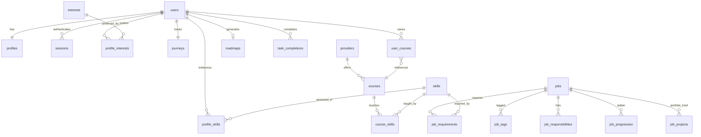

# Jom Kerja Lah — Data Model & Backend Design

Status: original design report; its SQLite persistence plan is superseded by the Supabase Postgres runtime.
Inputs: `product-requirements`, `jomworklah/js/mock-data.js`, `jomworklah/js/app.js`.
Current stack: Node.js 24 + Express, Supabase Postgres, deterministic rule engine behind an AI adapter, anonymous demo sessions.

The current SQL setup is maintained in [`supabase/schema.sql`](supabase/schema.sql),
[`supabase/app-schema.sql`](supabase/app-schema.sql), and [`supabase/seed.sql`](supabase/seed.sql).
The SQLite DDL and migration notes below are retained as historical design context; SQLite remains
only in the local test fixtures.

---

## 1. Scope and assumptions

The backend must serve the five product steps: assessment, career matching, gap analysis, TVET/training recommendations, and roadmap generation. It replaces local mock arrays and `localStorage` journeys with server-side state.

| Area | Decision | Rationale |
|---|---|---|
| Runtime | Node.js 24 + Express | Same language as the prototype, Node already installed |
| Persistence | SQLite (single file, WAL) | Zero setup, transactional, demo-friendly; schema ports to Postgres |
| Intelligence | Deterministic rule engine behind an AI port | Works offline; LLM/embeddings can be added without schema changes |
| Identity | Anonymous session tokens, no passwords | No login UI needed; judges can try multiple personas |
| Catalogue | Read-only, seeded from prototype | Skills/jobs/courses are curated, not user-generated |
| Skills Atlas | Stays static in the frontend | 150 KB of geometry and synthetic metrics; not user data |

Non-goals for this iteration: real job-board ingestion, payments, employer dashboards, production-grade rate limiting, and multilingual NLP.

---

## 2. Domain model

### 2.1 Core relationships



### 2.2 Entity catalogue

| Entity | Purpose | Key fields |
|---|---|---|
| `users` | Person record (guest, demo template, or demo clone) | `id`, `kind`, `persona_key`, timestamps |
| `sessions` | Bearer-token auth, multiple devices per user | `token_hash` (PK), `user_id`, `expires_at` |
| `profiles` | 1:1 editable career profile | qualification, field, location, experience, projects, budget, weekly hours, learning mode |
| `skills` | 18-skill catalogue | slug id, name, category, description |
| `profile_skills` | Evidence level 0–5 per skill | `(user_id, skill_id)`, `evidence_level` |
| `interests` / `profile_interests` | 7 interest clusters | slug id, label |
| `jobs` | 8 career paths | title, category, sector, summary, qualification note |
| `job_requirements` | Weighted skill requirements driving matching | `(job_id, skill_id)`, `level` 1–5, `weight` (sums to 1.0) |
| `job_tags` | Interest overlap for the 15% interest component | `(job_id, interest_id)` |
| `job_responsibilities`, `job_progression`, `job_projects` | Ordered display lists and portfolio briefs | `(job_id, position)`, text |
| `providers` | 5 Malaysian training portals | name, official URL |
| `courses` | 10 TVET/training pathways (illustrative) | mode, location, min/max weeks, nullable fee |
| `course_skills` | Which gaps a course closes | `(course_id, skill_id)` |
| `journeys` | Per-user target selection | `target_job_id`, `started` |
| `user_courses` | Course "added to roadmap" bookmarks | `(user_id, course_id)` |
| `roadmaps` | Generation snapshot | `target_job_id`, `weekly_hours`, `start_date`, `generated_at` |
| `task_completions` | Stable task IDs marked complete | `(user_id, task_id)` |

### 2.3 Important modelling decisions

1. **Roadmap tasks are derived on read, not persisted.** This mirrors the prototype exactly (`roadmapPhases()` recomputes from the plan, profile, and saved courses on every render). Task IDs are deterministic (`skill-<skillId>`, `course-<courseId>`, `project-<n>`, `prepare-resume`, etc.), so only completion state needs storage. This guarantees newly saved courses appear in the training phase without a migration, and avoids duplicating generated prose. If tasks later become editable, promote them to a `roadmap_tasks` table with no domain-model disruption.

2. **Target changes invalidate the roadmap.** The prototype reuses an old roadmap snapshot when the target changes, which produces mismatched foundation tasks. The backend fixes this: `PUT /api/me/target` deletes the roadmap row, its completions and the saved courses (which were chosen for the old target), and the UI must regenerate. This is a deliberate, documented divergence from the prototype.

3. **Demo personas are templates.** `POST /api/demo/session` deep-clones the seeded Aina/Amir profile, skills and interests into a fresh user, so multiple judges do not overwrite each other's progress. Templates carry `persona_key` and `kind='demo_template'`; clones record `source_persona` and start like the prototype (`started=false`, no target) so onboarding runs. The template's target is only surfaced as persona metadata.

6. **Roadmaps freeze their inputs.** Generation stores the top-3 gap `skillIds` and top-2 suggested `courseIds` in `roadmaps.skill_ids_json`/`course_ids_json`. Reads build phases from that snapshot plus the currently saved courses, so editing skills does not rewrite foundations until the user regenerates. Rows without a snapshot are backfilled on first read.

7. **API shapes follow the frontend.** Responses keep the canonical fields and add prototype aliases: profile `field`/`hours`/`mode`/`scores`/`interests`, course `provider` as an id string plus `providerName`/`providerUrl`, career `project`, task `course` objects and `progress.next`. Request bodies accept the same aliases.

4. **Weights are not enforced by SQLite.** SQLite cannot express "weights sum to 1" across rows. Seed validation and tests assert the invariant instead.

5. **Ordered prose lists are normalized**, not stored as JSON blobs, so they are queryable and typo-safe. Scoring relations (`job_requirements`, `course_skills`) are already normalized because they are queried at runtime.

---

## 3. SQLite schema

```sql
PRAGMA foreign_keys = ON;
PRAGMA journal_mode = WAL;
PRAGMA busy_timeout = 5000;

CREATE TABLE schema_migrations (
  version    INTEGER PRIMARY KEY,
  applied_at TEXT NOT NULL DEFAULT (strftime('%Y-%m-%dT%H:%M:%fZ','now'))
);

-- ── Identity ────────────────────────────────────────────────
CREATE TABLE users (
  id          TEXT PRIMARY KEY,
  kind        TEXT NOT NULL DEFAULT 'guest'
              CHECK (kind IN ('guest','demo_template','demo_clone','registered')),
  persona_key TEXT UNIQUE,          -- 'aina' | 'amir' on templates only
  created_at  TEXT NOT NULL DEFAULT (strftime('%Y-%m-%dT%H:%M:%fZ','now')),
  updated_at  TEXT NOT NULL DEFAULT (strftime('%Y-%m-%dT%H:%M:%fZ','now'))
);

CREATE TABLE sessions (
  token_hash   TEXT PRIMARY KEY,    -- sha256(hex) of bearer token
  user_id      TEXT NOT NULL REFERENCES users(id) ON DELETE CASCADE,
  created_at   TEXT NOT NULL DEFAULT (strftime('%Y-%m-%dT%H:%M:%fZ','now')),
  last_seen_at TEXT,
  expires_at   TEXT                 -- NULL = demo session, no expiry
);
CREATE INDEX idx_sessions_user ON sessions(user_id);

CREATE TABLE profiles (
  user_id       TEXT PRIMARY KEY REFERENCES users(id) ON DELETE CASCADE,
  name          TEXT NOT NULL DEFAULT 'Guest',
  headline      TEXT NOT NULL DEFAULT '',
  qualification TEXT NOT NULL DEFAULT '',
  field_of_study TEXT NOT NULL DEFAULT '',
  location      TEXT NOT NULL DEFAULT '',
  experience    TEXT NOT NULL DEFAULT '',
  projects      TEXT NOT NULL DEFAULT '',
  budget        TEXT NOT NULL DEFAULT 'Flexible'
                CHECK (budget IN ('RM0–RM500','RM501–RM1,500','Flexible')),
  weekly_hours  INTEGER NOT NULL DEFAULT 5 CHECK (weekly_hours BETWEEN 1 AND 60),
  learning_mode TEXT NOT NULL DEFAULT 'Online'
                CHECK (learning_mode IN ('Online','In person','Hybrid')),
  updated_at    TEXT NOT NULL DEFAULT (strftime('%Y-%m-%dT%H:%M:%fZ','now'))
);

-- ── Skills & interests ──────────────────────────────────────
CREATE TABLE skills (
  id          TEXT PRIMARY KEY,     -- 'sql', 'data-viz', ...
  name        TEXT NOT NULL UNIQUE,
  category    TEXT NOT NULL,        -- Digital/Technical/Analytical/...
  description TEXT NOT NULL DEFAULT ''
);

CREATE TABLE profile_skills (
  user_id        TEXT NOT NULL REFERENCES users(id) ON DELETE CASCADE,
  skill_id       TEXT NOT NULL REFERENCES skills(id) ON DELETE CASCADE,
  evidence_level INTEGER NOT NULL DEFAULT 0 CHECK (evidence_level BETWEEN 0 AND 5),
  updated_at     TEXT NOT NULL DEFAULT (strftime('%Y-%m-%dT%H:%M:%fZ','now')),
  PRIMARY KEY (user_id, skill_id)
);
CREATE INDEX idx_profile_skills_skill ON profile_skills(skill_id);

CREATE TABLE interests (
  id    TEXT PRIMARY KEY,           -- 'data', 'automotive', ...
  label TEXT NOT NULL
);

CREATE TABLE profile_interests (
  user_id     TEXT NOT NULL REFERENCES users(id) ON DELETE CASCADE,
  interest_id TEXT NOT NULL REFERENCES interests(id) ON DELETE CASCADE,
  PRIMARY KEY (user_id, interest_id)
);

-- ── Careers ─────────────────────────────────────────────────
CREATE TABLE jobs (
  id            TEXT PRIMARY KEY,   -- 'junior-data-analyst'
  title         TEXT NOT NULL,
  category      TEXT NOT NULL,
  sector        TEXT NOT NULL,
  icon          TEXT NOT NULL DEFAULT '',
  summary       TEXT NOT NULL,
  qualification TEXT NOT NULL DEFAULT ''
);

CREATE TABLE job_requirements (
  job_id   TEXT NOT NULL REFERENCES jobs(id) ON DELETE CASCADE,
  skill_id TEXT NOT NULL REFERENCES skills(id) ON DELETE RESTRICT,
  level    INTEGER NOT NULL CHECK (level BETWEEN 1 AND 5),
  weight   REAL NOT NULL CHECK (weight > 0 AND weight <= 1),
  PRIMARY KEY (job_id, skill_id)
);
CREATE INDEX idx_job_req_skill ON job_requirements(skill_id);

CREATE TABLE job_tags (
  job_id      TEXT NOT NULL REFERENCES jobs(id) ON DELETE CASCADE,
  interest_id TEXT NOT NULL REFERENCES interests(id) ON DELETE RESTRICT,
  PRIMARY KEY (job_id, interest_id)
);

CREATE TABLE job_responsibilities (
  job_id   TEXT NOT NULL REFERENCES jobs(id) ON DELETE CASCADE,
  position INTEGER NOT NULL CHECK (position >= 0),
  text     TEXT NOT NULL,
  PRIMARY KEY (job_id, position)
);

CREATE TABLE job_progression (
  job_id   TEXT NOT NULL REFERENCES jobs(id) ON DELETE CASCADE,
  position INTEGER NOT NULL CHECK (position >= 0),
  title    TEXT NOT NULL,
  PRIMARY KEY (job_id, position)
);

CREATE TABLE job_projects (
  job_id   TEXT NOT NULL REFERENCES jobs(id) ON DELETE CASCADE,
  position INTEGER NOT NULL CHECK (position >= 0),
  brief    TEXT NOT NULL,
  PRIMARY KEY (job_id, position)
);

-- ── Training ────────────────────────────────────────────────
CREATE TABLE providers (
  id   TEXT PRIMARY KEY,            -- 'elatih', 'tvet', ...
  name TEXT NOT NULL,
  url  TEXT NOT NULL
);

CREATE TABLE courses (
  id             TEXT PRIMARY KEY,
  title          TEXT NOT NULL,
  provider_id    TEXT NOT NULL REFERENCES providers(id) ON DELETE RESTRICT,
  mode           TEXT NOT NULL CHECK (mode IN ('Online','In person','Hybrid')),
  location       TEXT NOT NULL,
  min_weeks      INTEGER NOT NULL CHECK (min_weeks > 0),
  max_weeks      INTEGER NOT NULL CHECK (max_weeks >= min_weeks),
  fee            REAL,              -- NULL = price to verify
  is_illustrative INTEGER NOT NULL DEFAULT 1 CHECK (is_illustrative IN (0,1))
);
CREATE INDEX idx_courses_provider ON courses(provider_id);
CREATE INDEX idx_courses_mode ON courses(mode);
CREATE INDEX idx_courses_location ON courses(location);

CREATE TABLE course_skills (
  course_id TEXT NOT NULL REFERENCES courses(id) ON DELETE CASCADE,
  skill_id  TEXT NOT NULL REFERENCES skills(id) ON DELETE RESTRICT,
  PRIMARY KEY (course_id, skill_id)
);
CREATE INDEX idx_course_skills_skill ON course_skills(skill_id);

-- ── Journey, saved courses, roadmap ─────────────────────────
CREATE TABLE journeys (
  user_id       TEXT PRIMARY KEY REFERENCES users(id) ON DELETE CASCADE,
  started       INTEGER NOT NULL DEFAULT 0 CHECK (started IN (0,1)),
  target_job_id TEXT REFERENCES jobs(id) ON DELETE SET NULL,
  created_at    TEXT NOT NULL DEFAULT (strftime('%Y-%m-%dT%H:%M:%fZ','now')),
  updated_at    TEXT NOT NULL DEFAULT (strftime('%Y-%m-%dT%H:%M:%fZ','now'))
);

CREATE TABLE user_courses (
  user_id   TEXT NOT NULL REFERENCES users(id) ON DELETE CASCADE,
  course_id TEXT NOT NULL REFERENCES courses(id) ON DELETE CASCADE,
  added_at  TEXT NOT NULL DEFAULT (strftime('%Y-%m-%dT%H:%M:%fZ','now')),
  PRIMARY KEY (user_id, course_id)
);

CREATE TABLE roadmaps (
  user_id       TEXT PRIMARY KEY REFERENCES users(id) ON DELETE CASCADE,
  target_job_id TEXT NOT NULL REFERENCES jobs(id) ON DELETE RESTRICT,
  weekly_hours  INTEGER NOT NULL CHECK (weekly_hours BETWEEN 1 AND 60),
  start_date    TEXT,               -- ISO date, optional
  generated_at  TEXT NOT NULL DEFAULT (strftime('%Y-%m-%dT%H:%M:%fZ','now'))
);

CREATE TABLE task_completions (
  user_id      TEXT NOT NULL REFERENCES users(id) ON DELETE CASCADE,
  task_id      TEXT NOT NULL,       -- stable, derived id
  completed_at TEXT NOT NULL DEFAULT (strftime('%Y-%m-%dT%H:%M:%fZ','now')),
  PRIMARY KEY (user_id, task_id)
);
```

All user-owned rows cascade on user deletion (`DELETE /api/me`). Catalogue rows use `RESTRICT` on dependencies so accidental deletes fail loudly. Seed and migrations run inside a transaction.

---

## 4. Ported domain logic (must match the prototype)

### 4.1 Evidence and gaps

Evidence legend (0–5): no evidence → mentioned only → coursework → project evidence → substantial work → independently verified.

For a target job:

```
current  = profile_skills.evidence_level ?? 0
gap      = max(0, requirement.level - current)
priority = gap * requirement.weight
```

Sort gaps by `priority DESC`, then `weight DESC`, then skill name `ASC`.

### 4.2 Compatibility (exact rounding order matters)

```
skillsMatch   = round(100 * Σ min(current / level, 1) * weight)
interestMatch = 100 if any(job.tags ∩ profile.interests) else 50
fit           = round(0.85 * skillsMatch + 0.15 * interestMatch)
```

Note the inner `skillsMatch` is rounded before weighting. Preserve this.

### 4.3 Ranked careers

Sort by `fit DESC`, then `title ASC`. Search/category filters are applied before ranking.

### 4.4 Course relevance

```
relevance = Σ gap.priority for gaps whose skillId ∈ course.skillIds
```

Sort by `relevance DESC`, then mode match, then location match, then title. `view=suggested` keeps only `relevance > 0`; `view=all` shows everything. Budget filters:

- `within` → `fee IS NOT NULL AND fee <= limit`
- `verify` → `fee IS NULL`
- `All` → no fee predicate

Limits: `RM0–RM500` → 500, `RM501–RM1,500` → 1500, `Flexible` → ∞.

### 4.5 Roadmap generation (derived per request)

Inputs: roadmap row, current profile skills, target job, saved courses.

1. Gap skills = positive-gap requirements sorted by priority, first 3.
2. Course IDs = ranked courses with `relevance > 0`, excluding saved courses, first 2.
3. Phase weeks: `max(1, ceil(baseWeeks * 5 / weekly_hours))` for bases `[2, 3, 2, 1]`.
4. **Foundations** tasks: per gap skill:
   - practical skills (`tools`, `auto`, `electrical`, `safety`, `sensors`) → "Review X with a qualified instructor or supervisor."
   - otherwise → "Study the fundamentals of X and document a practice example."
   - if fewer than 2, add `foundation-inventory`; still fewer than 2, add `foundation-review`.
5. **Training** tasks: unique `(snapshot courseIds ∪ saved courses)` → `course-<id>` with course link; always add `training-schedule`; if no courses, `training-review`.
6. **Projects**: `project-1..n` from the job's project briefs (2 in seed data).
7. **Prepare**: `prepare-resume`, `prepare-interview`, `prepare-application`.

Progress: `done / total`, percent rounded, `nextTask` = first incomplete in phase-then-task order.

Edge cases handled explicitly:

- No target → `409 TARGET_REQUIRED` on generation; `GET /roadmap` returns `data: null`.
- Zero gaps → fallback inventory/review tasks.
- Fewer than two gap skills → fallback tasks.
- Duplicate course in snapshot and saved list → set union.
- Course deleted after completion → course link becomes `null`; completion row is pruned on read if its task ID no longer exists.
- Regeneration → completion rows for task IDs that still exist are preserved; orphans are deleted.
- Scores outside 0–5 → rejected by validation and check constraint.

### 4.6 Parity expectations (use as tests)

| Check | Expected |
|---|---|
| Aina → Junior Data Analyst | `skillsMatch` 54, interest 100, `fit` 61 |
| Amir → Automotive Technician | `skillsMatch` 73, interest 100, `fit` 77 |
| Aina's JDA gap order | SQL (0.9), Data Visualisation (0.75), Python (0.15) |
| Amir's automotive gap order | Safety (0.4), Electrical (0.3), Sensors (0.2), Troubleshooting (0.1) |
| Aina roadmap at 5 h/week | phase weeks `[2,3,2,1]`, 11 tasks |
| Amir roadmap at 8 h/week | phase weeks `[2,2,2,1]` |

---

## 5. API design

Base path: `/api`. JSON only. Auth via `Authorization: Bearer <token>`.

Response envelope:

```json
{ "data": { }, "meta": { } }
{ "error": { "code": "VALIDATION_ERROR", "message": "...", "details": [] } }
```

### 5.1 Endpoints

| Method | Path | Auth | Purpose |
|---|---|---|---|
| GET | `/health` | no | Liveness + DB check |
| POST | `/session` | no | Create guest user + token |
| GET | `/demo/personas` | no | List seeded persona summaries |
| POST | `/demo/session` | no | Clone a demo persona and issue token |
| GET | `/me` | yes | Profile (with `scores`/`interests`), skills, journey `{started,target,preferences,roadmap,added,completed}`, roadmap summary |
| PUT | `/me/onboarding` | yes | Atomically save profile form + interests + scores and set `started` |
| POST | `/me/profile/sample-reset` | yes | Demo clones only: restore persona profile/skills/interests, keep journey |
| PATCH | `/me/profile` | yes | Update profile fields |
| PUT | `/me/skills` | yes | Bulk upsert evidence scores |
| PATCH | `/me/skills/:skillId` | yes | Update one evidence score |
| PUT | `/me/interests` | yes | Replace interest set |
| GET | `/skills` | no | Skill catalogue + evidence legend |
| GET | `/interests` | no | Interest catalogue as `{id: label}` map |
| GET | `/providers` | no | Provider catalogue as `{id: {name, url}}` map |
| GET | `/careers?query=&category=&sort=match|title` | yes | Ranked careers with fit |
| GET | `/careers/:id` | yes | Detail + requirements + per-skill gaps + explanation |
| GET | `/training?view=suggested|all&skill=&source=&mode=&location=&budget=&sort=relevance|name` | yes | Ranked/filtered pathways |
| GET | `/training/:id` | yes | Course detail + provider |
| PUT | `/me/target` | yes | Set target (`jobId` or `target`); a change clears roadmap, completions and saved courses |
| GET | `/me/courses` | yes | Saved courses |
| POST | `/me/courses` | yes | Save course (`courseId` or `id`); needs a target; 409 if already saved or in the roadmap snapshot |
| DELETE | `/me/courses/:courseId` | yes | Unsave course |
| GET | `/me/roadmap` | yes | Derive phases, tasks, progress |
| POST | `/me/roadmap` | yes | Generate/regenerate with `weeklyHours` (or `hours`), optional `startDate` (or `start-date`); freezes `skillIds`/`courseIds` |
| PATCH | `/me/roadmap/tasks/:taskId` | yes | Mark complete/incomplete |
| POST | `/me/roadmap/reset-progress` | yes | Clear completions, keep roadmap |
| DELETE | `/me/journey` | yes | Clear target, roadmap, saved courses |
| DELETE | `/me` | yes | Delete user and all data |
| POST | `/ai/assessment` | yes | Rule/LLM narrative → detected skills & interests |
| POST | `/ai/explain-match` | yes | Human-readable fit explanation for a job |
| POST | `/dev/reset` | dev only | Wipe and reseed; blocked unless `ALLOW_DEV_RESET=1` |

### 5.2 Representative payloads

`POST /api/demo/session`

```json
// request
{ "personaKey": "aina" }

// 201 response
{
  "data": {
    "token": "b64url-32-bytes",
    "user": { "id": "usr_...", "kind": "demo_clone" },
    "profile": { "name": "Aina Rahman", "qualification": "Diploma", "...": "..." },
    "journey": { "started": true, "targetJobId": "junior-data-analyst" }
  }
}
```

`GET /api/careers/junior-data-analyst` (condensed)

```json
{
  "data": {
    "id": "junior-data-analyst",
    "title": "Junior Data Analyst",
    "requirements": [
      { "skillId": "sql", "level": 4, "weight": 0.3, "current": 1, "gap": 3, "priority": 0.9 },
      { "skillId": "data-viz", "level": 4, "weight": 0.25, "current": 1, "gap": 3, "priority": 0.75 },
      { "skillId": "python", "level": 3, "weight": 0.15, "current": 2, "gap": 1, "priority": 0.15 }
    ],
    "compatibility": { "fit": 61, "skillsMatch": 54, "interestMatch": 100 },
    "explanation": "Your existing Excel and communication evidence covers 54% of the weighted requirements. SQL is the largest gap (3 levels, 30% weight), followed by Data Visualisation."
  }
}
```

`POST /api/me/roadmap`

```json
// request
{ "weeklyHours": 5, "startDate": "2026-11-20" }
```

`GET /api/me/roadmap` (condensed)

```json
{
  "data": {
    "roadmap": { "targetJobId": "junior-data-analyst", "weeklyHours": 5, "startDate": "2026-11-20", "generatedAt": "2026-11-19T..." },
    "phases": [
      {
        "id": "foundations", "title": "Build Foundations", "goal": "Develop the evidence you need for this role.",
        "weeks": 2,
        "tasks": [
          { "id": "skill-sql", "title": "Study the fundamentals of SQL and document a practice example.", "courseId": null, "completed": false }
        ]
      }
    ],
    "progress": { "done": 0, "total": 11, "percent": 0, "nextTaskId": "skill-sql" }
  }
}
```

`PATCH /api/me/roadmap/tasks/skill-sql`

```json
{ "data": { "taskId": "skill-sql", "completed": true, "progress": { "done": 1, "total": 11, "percent": 9 } } }
```

`POST /api/ai/assessment`

```json
// request
{ "narrative": "I helped my aunt track stock in Excel and wrote a few SQL queries for a class project." }

// response
{ "data": {
    "provider": "rule",
    "detectedSkills": [
      { "skillId": "excel", "confidence": 0.9, "suggestedLevel": 3, "reason": "Mentions spreadsheets and tracking stock" },
      { "skillId": "sql", "confidence": 0.8, "suggestedLevel": 2, "reason": "Mentions writing SQL queries" }
    ],
    "suggestedInterests": ["data", "business"]
} }
```

### 5.3 Status codes

| Code | Use |
|---|---|
| 200 | Read/update success |
| 201 | Session, generation, course save |
| 204 | Deletes |
| 400 | Validation failure |
| 401 | Missing/unknown/expired token |
| 403 | Dev endpoint disabled |
| 404 | Unknown job/course/task |
| 409 | Roadmap requested without target; duplicate constraints |
| 500 | Unexpected error (logged, generic message) |

---

## 6. Backend module layout

```
jomworklah-backend/
  package.json
  .env.example
  .gitignore
  README.md
  data/                     # runtime SQLite file (gitignored)
  src/
    server.js               # listen + graceful shutdown
    app.js                  # express app factory (testable)
    config.js               # env parsing, defaults
    db/
      connection.js         # DatabaseSync, pragmas, transaction helper
      migrate.js            # schema_migrations + v1 DDL
      seed.js               # idempotent catalogue + persona seeding
      seed-data.js          # ported from js/mock-data.js
      validate-seed.js      # weights sum to 1, refs exist
    domain/
      scoring.js            # gapsFor, compatibility, rankedCareers, rankedCourses
      roadmap.js            # buildRoadmap, progress, task IDs
      assessment-rule.js    # keyword/alias extraction, interest inference
    services/
      profile-service.js
      career-service.js
      training-service.js
      journey-service.js
      session-service.js
      demo-service.js
    routes/
      sessions.js  profile.js  catalogue.js  careers.js
      training.js  roadmap.js  ai.js  dev.js
    middleware/
      auth.js               # bearer → session → req.user
      validate.js           # zod schema wrapper
      errors.js             # AppError + JSON handler
      not-found.js
    ai/
      index.js              # adapter selection from env
      rule-adapter.js       # default, deterministic
      llm-adapter.js        # optional OpenAI-compatible fetch, fallback to rule
  test/
    scoring.test.js
    roadmap.test.js
    api.test.js
    seed.test.js
  scripts/
    smoke.sh
```

Why this shape: routes stay thin, domain logic is pure and unit-testable without HTTP or SQL, and the AI port sits beside domain code so swapping providers never touches routes.

Database driver: prefer Node 24's built-in `node:sqlite` (`DatabaseSync`) to avoid native compilation. It may emit an experimental warning; if it proves unstable, `better-sqlite3` is a drop-in with the same synchronous API. Verify availability at build start.

---

## 7. AI adapter design

```js
// ai/index.js
export interface AssessmentPort {
  analyzeNarrative({ narrative, skills, interests }): Promise<AssessmentResult>
  explainMatch({ profile, job, gaps, compatibility }): Promise<string>
  narrateRoadmap({ job, phases }): Promise<string>
}
```

- **Default `rule-adapter`**: alias table per skill (e.g. SQL: `sql`, `database`, `query`; Excel: `excel`, `spreadsheet`, `sheet`), sentence-level hits, confidence by hit count, suggested level capped at 3. Interest inference from keyword sets. Deterministic and offline.
- **Optional `llm-adapter`**: enabled by `AI_PROVIDER=openai` plus `AI_API_KEY`, `AI_BASE_URL`, `AI_MODEL`. Uses `fetch` with an 8-second timeout and strict JSON parsing; any failure falls back to the rule adapter. Never blocks scoring or roadmap generation.
- **Future semantic matching**: add a `skill_similarity` provider (Python + sentence-transformers or a hosted embedding API) that returns `{skillId, similarity}` pairs. It plugs into `rankedCareers`/`rankedCourses` as an additional scoring signal. No schema change is required; embeddings can live in a side table or an external service. This preserves the product's "meaning, not keywords" story without reworking the domain tables.

---

## 8. Seeding strategy

- Source of truth: a typed port of `jomworklah/js/mock-data.js` (18 skills, 7 interests, 2 personas, 8 jobs, 5 providers, 10 courses).
- `npm run db:migrate` applies versioned DDL.
- `npm run db:seed` runs inside one transaction with `INSERT OR IGNORE` for catalogue rows and an upsert for templates; re-running is safe.
- Seed validation fails the process if any job's requirement weights do not sum to 1.0 (±0.001), any skill/course reference is missing, or pathway counts differ from expectations.
- Demo templates: Aina with target `junior-data-analyst`, Amir with target `automotive-technician`, both `started = 1`, no roadmap. Their scores/interests match the prototype exactly so parity tests are meaningful.
- Demo impersonation clones the template into a fresh user; templates remain untouched.
- Fees stay `NULL` (price to verify), preserving the prototype's honesty about illustrative programmes.

---

## 9. Security, integrity, and operations

| Concern | Approach |
|---|---|
| SQL injection | Prepared statements only; no string-built SQL; `ORDER BY` mapped from a fixed whitelist |
| Auth | 32-byte random token, base64url; only SHA-256 hash stored; bearer header; sessions cascade on user delete |
| Validation | Zod schemas per route; unknown keys stripped; string length caps (narrative ≤ 5,000 chars, name ≤ 120) |
| Payload size | `express.json({ limit: '128kb' })` |
| CORS | Allowlist `FRONTEND_ORIGIN`; bearer tokens used, so no cookies/credentials |
| Dev reset | Only when `ALLOW_DEV_RESET=1` and `NODE_ENV !== 'production'` |
| Concurrency | WAL mode, `busy_timeout`, transactions for multi-table writes (target change, generation, seeding) |
| Errors | Central handler; no stack traces in responses; structured logs with request ID |
| Privacy | No email/password; `DELETE /api/me` hard-deletes all user rows |
| Rate limiting | Optional per-IP limiter (120 req/min) behind env flag; skipped for local demo |
| Secrets | `.env` gitignored; `.env.example` committed |

Configuration:

```
PORT=8787
DB_PATH=./data/jomworklah.db
FRONTEND_ORIGIN=http://localhost:8080
STATIC_DIR=../jomworklah        # optional: serve prototype from same origin
AI_PROVIDER=rule
AI_API_KEY=
AI_BASE_URL=https://api.openai.com/v1
AI_MODEL=
ALLOW_DEV_RESET=1
```

---

## 10. Frontend integration plan (least invasive)

Recommended: serve the static prototype from Express (`STATIC_DIR=../jomworklah`) so the demo runs on one origin at `http://localhost:8787/`. This eliminates CORS and the `file://` fetch restriction.

Then introduce `jomworklah/js/api.js` with functions mirroring current data access, and a build-time/runtime flag (`?api=1`) so the mock-only demo still works as a fallback.

Specific touchpoints in `js/app.js`:

| Current code | Replacement |
|---|---|
| `const saved = loadDemo()` / `persist()` | `GET /api/me`, mutation calls; drop `localStorage` journeys |
| Static `skills`, `jobs`, `courses`, `personas` | Fetch `/api/skills`, `/api/careers`, `/api/training`, `/api/demo/personas` |
| `gapsFor`, `compatibility`, `rankedJobs`, `rankedCourses` | Use server fields (`requirements[].gap/priority`, `fit`, `relevance`) |
| `makeRoadmap` / `generateSnapshot` | `POST /api/me/roadmap` |
| `roadmapPhases()` | Render `GET /api/me/roadmap` phases |
| `updateTask` | `PATCH /api/me/roadmap/tasks/:id` |
| `addCourse` | `POST /api/me/courses` |
| `setTarget` | `PUT /api/me/target` |
| `saveProfile` | `PATCH /api/me/profile`, `PUT /api/me/skills`, `PUT /api/me/interests` |
| `simulateResume` | `POST /api/ai/assessment` with extracted text |

Skills Atlas (`skills-atlas.js`, `skills-atlas-data.js`) remains untouched.

---

## 11. Verification plan

Automated (`node:test`):

1. **Scoring parity** — Aina/JDA `fit=61`, Amir/Automotive `fit=77`, gap ordering, interest-match branch, rounding at boundaries, level cap.
2. **Roadmap** — weeks formula for 3/5/8 hours, fallback tasks, stable IDs, union of saved courses without duplicates, completion preservation on regeneration, orphan pruning.
3. **Seed** — idempotent rerun, weights sum to 1, FK integrity, expected counts (18/8/10/5/7/2).
4. **API** — session bootstrap, profile update, target set, roadmap generate, task toggle, reset, unauthorized access, validation errors.

Manual smoke (`scripts/smoke.sh`):

```bash
BASE=http://localhost:8787/api
TOKEN=$(curl -s -X POST $BASE/demo/session \
  -H 'content-type: application/json' -d '{"personaKey":"aina"}' | jq -r .data.token)
curl -s $BASE/me -H "authorization: Bearer $TOKEN" | jq
curl -s "$BASE/careers?sort=match" -H "authorization: Bearer $TOKEN" | jq '.data[0]'
curl -s "$BASE/careers/junior-data-analyst" -H "authorization: Bearer $TOKEN" | jq '.data.compatibility'
curl -s "$BASE/training?view=suggested" -H "authorization: Bearer $TOKEN" | jq '.data[0]'
curl -s -X POST "$BASE/me/roadmap" -H "authorization: Bearer $TOKEN" \
  -H 'content-type: application/json' -d '{"weeklyHours":5}' | jq
curl -s -X PATCH "$BASE/me/roadmap/tasks/skill-sql" -H "authorization: Bearer $TOKEN" \
  -H 'content-type: application/json' -d '{"completed":true}' | jq
```

Expected: Aina's top career is Junior Data Analyst with `fit: 61`; SQL is the top gap; suggested pathways lead with SQL Foundations and Dashboard Design; roadmap has 11 tasks across four phases.

---

## 12. Build order and risk register

Phased implementation:

1. Scaffold, config, DB connection, migration runner.
2. Seed data + validation + `db:seed`.
3. Pure scoring and roadmap modules + parity tests.
4. Auth, error/validation middleware, session and demo routes.
5. Profile, catalogue, careers, training routes.
6. Journey, roadmap, AI assessment routes.
7. API tests, smoke script, README, optional static serving.
8. Frontend adapter behind `?api=1`.

Risks:

| Risk | Mitigation |
|---|---|
| `node:sqlite` experimental behaviour | Verify first; fallback to `better-sqlite3` |
| Express 5 API differences | Pin the major version; keep handlers framework-thin |
| Demo persona collision | Clone templates per session |
| Roadmap/target mismatch (prototype bug) | Invalidate roadmap on target change; document |
| Illustrative fees look real | Keep `fee = NULL`, surface "price to verify" |
| CORS with `file://` | Serve prototype from Express; recommend local HTTP |
| Roadmap drift if algorithm changes | Stable task IDs + completion preservation; parity tests |
